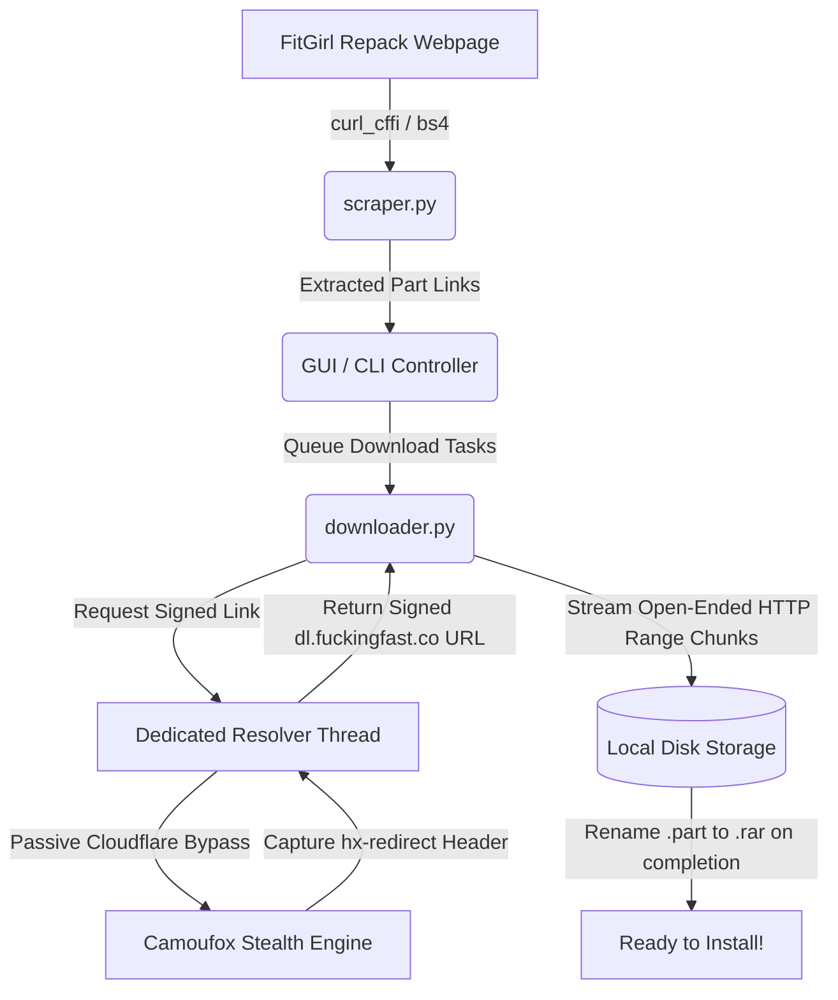

# FitGirl Fast Downloader ⚡

[](https://www.python.org/)
[](LICENSE)
[]()
[](https://github.com/psf/black)

An automated, high-speed multi-part downloader engineered specifically for downloading large game repacks from **FitGirl Repacks** hosted on **FuckingFast (dl.fuckingfast.co)**.

Built to eliminate the tedious manual process of clicking through 100+ split archive links, bypassing Cloudflare Turnstile challenges, and handling download resumes seamlessly.

---

## 🌟 Key Features

- **Automated Mirror Scraping**: 
  Instantly scrapes any FitGirl game page (defaults to *Grand Theft Auto V*), automatically discovering and categorizing all split `.rar` parts (e.g. all **105 parts** + `setup_proper.exe`) and optional bonus content.
- **Stealth Cloudflare Bypass**:
  Powered by an anti-detect browser engine ([Camoufox](https://github.com/DaiSoraSui/camoufox)) that silently clears Cloudflare's passive JavaScript/Turnstile verification to capture pre-signed, direct `dl.fuckingfast.co` download URLs without user intervention.
- **Dedicated Resolver Actor Pattern**:
  Thread-safe architecture prevents browser greenlet collisions across concurrent download workers, ensuring smooth, uninterrupted resolution for dozens or hundreds of parts.
- **Select Custom Save Location**:
  Pick any directory or hard drive with a native folder dialog. Automatically displays real-time free disk space on the selected drive and warns if space is insufficient.
- **Full Resumption & Crash Protection**:
  All files stream into temporary `.part` files using HTTP `Range` headers. If your connection drops or your computer restarts, downloads resume right where they left off without losing a single megabyte. Finished files are verified and automatically skipped.
- **Intelligent Rate-Limit Handling**:
  Built-in exponential backoff automatically handles host rate limits (`HTTP 429`) and token expirations (`401`/`403`/`410`), dynamically re-resolving URLs when necessary.
- **Modern Dark GUI & Headless CLI**:
  A sleek dark-mode desktop interface built with **CustomTkinter** featuring live download speeds, ETA counters, individual part statuses, and a "Retry Failed" button. Also features a fully functional CLI for headless servers.

---

## 🖥️ Graphical Interface Preview

```text
+----------------------------------------------------------------------------------+
|  GTA V FitGirl Repack Downloader (FuckingFast)                                   |
|  High-speed multi-part downloader with Cloudflare bypass & HTTP resume support   |
+----------------------------------------------------------------------------------+
| FitGirl URL:   [ https://fitgirl-repacks.site/grand-theft-auto-v/ ] [ Fetch Links ] |
| Save Location: [ D:\Games\GTA_V                             ] [Browse] Free: 140GB |
+----------------------------------------------------------------------------------+
| [x] Main Game (105 Parts + Setup)  [ ] Bonus Content  Concurrent: [ 2 ] [Retry]   |
+----------------------------------------------------------------------------------+
| Overall Progress: [=======================>             ] 45.2%                  |
| Parts: 48 / 106 Completed | Downloaded: 24.1 GB / 53.2 GB | Speed: 24.5 MB/s     |
+----------------------------------------------------------------------------------+
| #   | File Name                                      | Size   | Progress | Status  |
| 1   | setup_proper.exe                               | 9.0 MB | 100%     | Done    |
| 2   | GTAV_Legacy_--_fitgirl-repacks.site_--_.part001| 500 MB | 100%     | Done    |
| 3   | GTAV_Legacy_--_fitgirl-repacks.site_--_.part002| 500 MB | 74.2%    | DL      |
| 4   | GTAV_Legacy_--_fitgirl-repacks.site_--_.part003| 500 MB | 12.0%    | DL      |
+----------------------------------------------------------------------------------+
| [ START DOWNLOAD ]     [ Pause ]     [ Stop / Cancel ]     [ Open Folder ]       |
+----------------------------------------------------------------------------------+
```

---

## 📦 Requirements

- **Python 3.10 or higher**
- Supported OS: Windows 10/11, Linux, macOS

---

## 🚀 Installation & Quick Start

### 1. Clone the Repository
```bash
git clone https://github.com/your-username/fitgirl-fast-downloader.git
cd fitgirl-fast-downloader
```

### 2. Install Python Dependencies
```bash
pip install -r requirements.txt
```

### 3. Fetch Browser Binaries
Camoufox requires a stealth browser binary to handle Cloudflare challenges:
```bash
python -m camoufox fetch
```

---

## 🎮 How to Use

### Method 1: Graphical Desktop App (Recommended)

**On Windows:**
Simply double-click the included `run.bat` file, or run:
```bash
python main.py
```

1. Enter or keep the pre-filled FitGirl page URL.
2. Click **Browse...** to select where you want your game parts downloaded.
3. Verify your parts in the table and click **START DOWNLOAD**.
4. Once completed, run `setup_proper.exe` inside your destination folder to install the game!

---

### Method 2: Command Line (CLI / Headless Mode)

For servers, headless setups, or users who prefer the terminal:

```bash
# Basic run with default GTA V URL:
python main.py --cli --dest "D:\Games\GTA_V"

# Specify a custom game page and concurrency:
python main.py --cli --url "https://fitgirl-repacks.site/cyberpunk-2077/" --dest "D:\Games\CP2077" --concurrent 2

# Include optional bonus content:
python main.py --cli --dest "D:\Downloads\Game" --bonus
```

#### CLI Arguments Reference

| Flag | Type | Default | Description |
| :--- | :--- | :--- | :--- |
| `--cli` | Flag | `False` | Run in headless CLI mode instead of GUI. |
| `--url` | String | *GTA V URL* | URL of the FitGirl repack page. |
| `--dest` | String | `~/Downloads/GTA_V_FitGirl` | Directory where downloaded parts are saved. |
| `--concurrent`| Integer | `2` | Number of simultaneous file downloads (1 to 6). |
| `--bonus` | Flag | `False` | Include optional bonus content archives. |
| `-h`, `--help` | Flag | - | Display help menu and exit. |

---

## ⚙️ Architecture & Under the Hood



- **Two-Phase Scraper**: Utilizes TLS fingerprint impersonation (`curl_cffi`) for instant (sub-second) parsing of FitGirl HTML, falling back to full headless browser emulation only when necessary.
- **Dedicated Resolver Thread**: Playwright sync instances require strict thread affinity. Our `DedicatedResolverWorker` handles all link captures sequentially inside an isolated actor thread, eliminating cross-thread greenlet exceptions.
- **Safe Concurrency**: Tuned default concurrency of 2-3 simultaneous connections maximizes bandwidth without tripping the host's strict IP rate limits.

---

## ❓ Troubleshooting & FAQ

<details>
<summary><b>Q: What if I encounter "HTTP 429 Too Many Requests"?</b></summary>
FuckingFast enforces IP-level rate limits when too many requests hit their servers in short bursts. The downloader will automatically pause, wait for the cooldown timer, and resume. You can also lower concurrency to 1 or 2 in the GUI.
</details>

<details>
<summary><b>Q: Can I use this for other games on FitGirl?</b></summary>
Yes! Paste any FitGirl game page URL that lists <code>Filehoster: FuckingFast</code> into the input field and click <b>Fetch Links</b>.
</details>

<details>
<summary><b>Q: What happens if my internet disconnects?</b></summary>
The app automatically preserves all downloaded <code>.part</code> files. When reconnected, simply restart the download or click <b>Retry Failed</b>—it will resume exactly where it was interrupted.
</details>

<details>
<summary><b>Q: How do I extract the downloaded game?</b></summary>
Once all parts are downloaded into the same folder, open <code>setup_proper.exe</code> (or extract <code>part001.rar</code> using 7-Zip or WinRAR; it will automatically read all other parts).
</details>

---

## 📄 License

This project is licensed under the [MIT License](LICENSE).

---

## ⚠️ Disclaimer

This tool is created strictly for educational and personal automation purposes. It simply automates standard web browser navigation to download files publicly mirrored by repackers. Please respect intellectual property laws and terms of service of the respective hosts.
